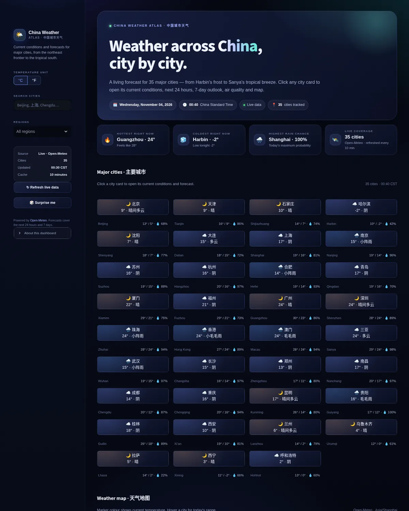
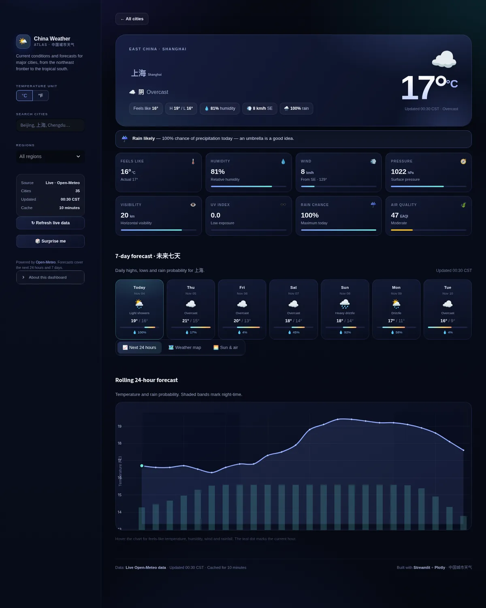
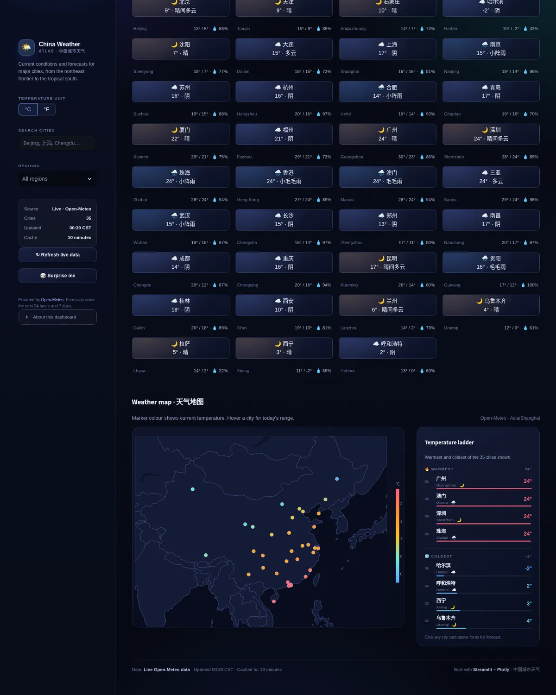

# China Weather Atlas · 中国城市天气

A polished Streamlit dashboard for live weather across **35 major Chinese cities** — from
Harbin's frost to Sanya's tropical breeze. Click any city card to open its full forecast.



## Highlights

- **35 cities** across eight regions, each with current conditions, today's high/low,
  humidity and rain chance.
- **Click-through detail page** for every city: hero conditions, eight live metrics,
  a 7-day forecast strip, a 24-hour temperature/rain chart, a map with the selected city
  starred, plus sunrise/sunset and air quality.
- **Interactive China map** (Plotly) coloured by current temperature, paired with a
  warmest/coldest temperature ladder.
- **Smart filters** — search in English or Chinese, filter by region, switch between °C
  and °F, toggle the whole interface between **English and 中文**, switch between
  **light and dark themes**, and hit "Surprise me" for a random city.
- **Deep links** — every city has a URL such as `/?city=shanghai`; the back button
  restores the grid.
- **Resilient by design** — live Open-Meteo data is cached for 10 minutes and the app
  falls back to a deterministic, realistic demo forecast if the network is unavailable.
- **Beautiful glassy UI** — polished dark and light themes, temperature-tinted
  gradients, condition-aware icons, responsive layout, bilingual labels and a bundled
  emoji font so icons render even on machines without a system emoji font.

| Detail page | Map & ladder |
| --- | --- |
|  |  |

## Quickstart

```bash
python -m venv .venv
source .venv/bin/activate
pip install -r requirements.txt
streamlit run app.py
```

Then open <http://localhost:8501>. No API key is required.

## Project layout

```
app.py                       Streamlit entry point and page routing
weather_dashboard/
  cities.py                  City catalogue + WMO weather-code metadata
  api.py                     Open-Meteo fetching, normalisation, demo fallback
  components.py              HTML fragments and theme-aware Plotly charts
  styles.py                  Global CSS (dark base + light theme, cards, responsive rules)
  i18n.py                    English/Chinese copy, date and region labels
static/emoji.woff2           Subset of Noto Color Emoji used by the UI
.streamlit/config.toml       Dark theme + static file serving
tests/                       Offline unit tests + headless AppTest smoke tests
```

## Data

- Forecasts: [Open-Meteo](https://open-meteo.com/) — current conditions, hourly and
  7-day data (`Asia/Shanghai` timezone).
- Air quality: Open-Meteo Air Quality API (European AQI, PM2.5, PM10, O₃, NO₂).
- Responses are cached for 10 minutes (`st.cache_data`); "Refresh live data" clears
  the cache. When requests fail, the app shows a clearly-labelled demo dataset instead
  of an error page.

## Tests

```bash
python -m pytest
```

The suite covers data normalisation, the offline fallback, HTML fragment regressions
(blank lines would break Streamlit's markdown HTML blocks), theme palettes and drives
the app headlessly with `streamlit.testing.v1.AppTest`: overview, search/filter, unit
switch, language and theme toggles, city navigation and back.

## Notes

- The bundled `static/emoji.woff2` is a 33-glyph subset of
  [Noto Color Emoji](https://fonts.google.com/noto/specimen/Noto+Color+Emoji),
  licensed under the SIL Open Font License 1.1 (see
  `static/OFL-NotoColorEmoji.txt`). It is served through Streamlit's static file
  serving (`server.enableStaticServing = true`).
- Weather icons use the WMO interpretation codes returned by Open-Meteo.
